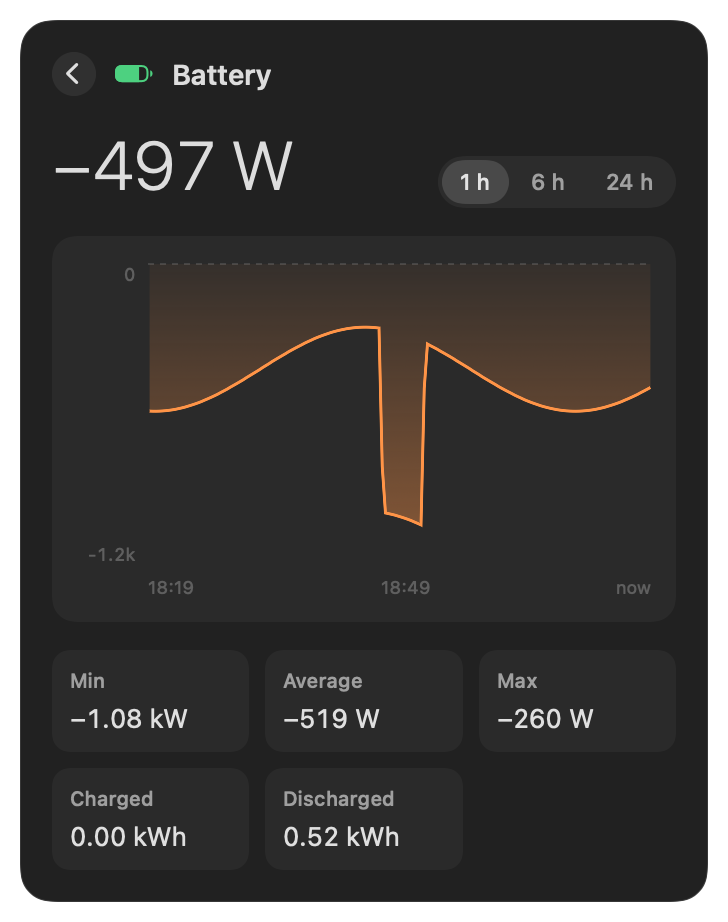
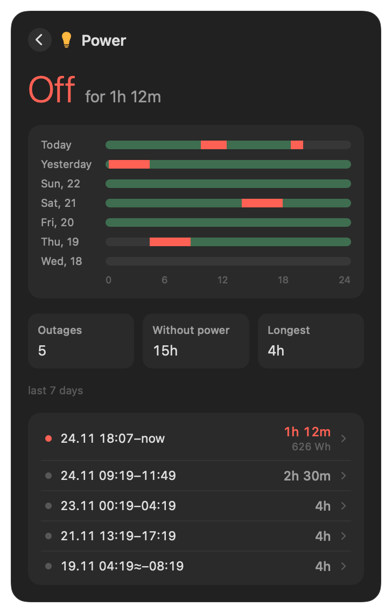

<p align="center">
  <a href="README.md">🇺🇦 Українська</a> · <b>🇬🇧 English</b>
</p>

<h1 align="center">JackeryBar</h1>

<p align="center">
  A macOS menu bar widget for <b>Jackery SolarVault 3</b> home batteries.<br>
  State of charge, how long the battery will last, charts and a power-outage log.<br>
  Fully local over MQTT, with no Jackery cloud involved.
</p>

<p align="center">
  
</p>

<p align="center">
  
  &nbsp;
  
</p>

> [!NOTE]
> Unofficial project, not affiliated with Jackery. The protocol comes from
> [Jackery's official Home Assistant integration](https://github.com/Jackery-Official/jackery) (MIT).

---

## Contents

- [Features](#features)
- [Screenshots](#screenshots)
- [How it works](#how-it-works)
- [Requirements](#requirements)
- [Installation](#installation)
- [Connecting the station](#connecting-the-station)
- [Configuration](#configuration)
- [Where data is stored](#where-data-is-stored)
- [How runtime is estimated](#how-runtime-is-estimated)
- [Supported devices](#supported-devices)
- [Troubleshooting](#troubleshooting)
- [Development](#development)
- [Credits](#credits)
- [License](#license)

## Features

### Menu bar
- **State of charge** and **runtime left** at the current load, e.g. `CHARGE 73% · LEFT ~5h 10m`. Styled like [Stats](https://github.com/exelban/stats) widgets: a small caption above the value.
- While **charging**, the right column shows the time to full (`TO 100% ~1h 15m`) and the battery icon gets a bolt.
- During a **power outage** the caption changes to `OUTAGE`.
- The battery icon fills with the charge level. When the station goes silent, the icon dims.

### Panel (click the widget)
- **Charge ring** (green, amber or red depending on the level), big runtime estimate and the current load.
- **Power card**: whether mains power is on, how long it has been out and how many outages there were in the last 24 h.
- **Battery chart for the last hour**: charging in green, discharging in orange.
- **Tiles**: grid, AC outlet, battery (with inverter efficiency), available energy, cell temperature, station Wi‑Fi. A Solar tile appears if the station has PV.
- **УКР | EN** language switch, settings, reconnect.
- Dark theme by default; light and system themes are available too.

### A chart for every metric
Click any tile to open a detailed chart:
- **1 h / 6 h / 24 h** ranges;
- exact value and time under the cursor;
- **min, average, max**, plus energy over the range for power metrics (charged/discharged, imported/exported, consumed).

### Power and outages
- The station reports grid presence itself (`ongridStat`), so outages are detected for real rather than guessed from "0 W".
- **macOS notifications** when power goes out ("Station on battery: 77%, lasts ~5h 10m") and when it's back ("Outage lasted 2h 14m").
- **A week at a glance**: one bar per day with outages in red, outage count, total time without power, longest outage.
- **A page for every outage**:
  - charge before → after;
  - how much the devices consumed, how much the battery gave, efficiency and losses;
  - minimum, average and peak load;
  - drain in %/h, temperature;
  - for an ongoing outage: how much longer the battery will last;
  - three charts: load, charge, battery.

### Also
- **Self-learning inverter efficiency**: the widget learns how much the battery gives per watt at the outlet and accounts for losses in the runtime estimate.
- **Settings right in the panel**: broker, station, capacity, theme, launch at login.
- **Localization**: Ukrainian (default) and English.
- **Everything stays local**: 24 h metric history, a 90-day outage log, plain JSON files.

## Screenshots

| Panel (light theme) | Metric chart | Outages this week |
|:---:|:---:|:---:|
|  |  |  |

| Single outage | Settings |
|:---:|:---:|
|  |  |

Screenshots use demo data (`./scripts/screenshots.sh`).

## How it works

```
┌──────────────────┐   MQTT    ┌──────────────────────┐   MQTT    ┌──────────────┐
│ Jackery          │ ────────▶ │ MQTT broker          │ ◀──────── │ JackeryBar   │
│ SolarVault 3     │ ◀──────── │ (Mosquitto on a Mac) │ ────────▶ │ (menu bar)   │
└──────────────────┘           └──────────────────────┘           └──────────────┘
```

1. In the Jackery app you point the station at **your own** MQTT broker on the LAN.
2. JackeryBar connects to the same broker and asks the station for data every 5 seconds: `type 25` (device status) and `type 105` (full system data) requests on `hb/device/<SN>/action`.
3. The station answers on `hb/device/<SN>/status` and `…/event`. Every request carries the token the Jackery app generates.

The Jackery cloud isn't needed. The MQTT client is built in (MQTT 3.1.1 on `Network.framework`), with no third-party dependencies.

## Requirements

- macOS 14 Sonoma or later, Apple Silicon or Intel.
- Xcode or the Command Line Tools (`xcode-select --install`) for `swiftc`.
- [Homebrew](https://brew.sh) to install the Mosquitto broker (or any other MQTT broker on your network).
- Jackery app **2.0.0+**, which added the MQTT settings.
- The station and the Mac on the same local network.

## Installation

```bash
git clone https://github.com/Loony-dev/jackerybar.git
cd jackerybar
./build.sh --install
open ~/Applications/JackeryBar.app
```

`build.sh` builds a universal `.app` (arm64 + x86_64) and signs it ad-hoc. With `--install` it copies the app into `~/Applications` and restarts it. No Xcode project is needed.

## Connecting the station

### 1. MQTT broker

The easiest way is to run Mosquitto on this Mac:

```bash
./scripts/setup-mosquitto.sh
```

The script:
- installs Mosquitto via Homebrew;
- creates user `jackery` with a random password;
- runs the broker as a background service on port 1883;
- prints what to enter in the Jackery app.

An existing broker works too, for example Home Assistant's Mosquitto add-on.

### 2. Jackery app

**Device → Settings → MQTT**:

| Field | Value |
|---|---|
| Server IP | your Mac's IP (the script prints it) |
| Port | `1883` |
| Username / password | from the script output |

Enable MQTT. The app shows a **token**, which you'll enter in JackeryBar. The station serial number is in the device info.

### 3. JackeryBar

Click the widget → ⚙️ **Settings** and fill in:

- **MQTT broker:** `127.0.0.1` (if the broker runs on this Mac), port, username and password;
- **Station:** serial number and token.

Click **Save**. Data shows up within a few seconds.

> [!TIP]
> Reserve this Mac's IP in your router (DHCP reservation). Otherwise the station loses the broker when the address changes.

## Configuration

Everything lives in `~/.config/jackery-bar/config.json`. You'll normally edit it through the settings page, but the file can be edited by hand too:

```json
{
  "host": "127.0.0.1",
  "port": 1883,
  "username": "jackery",
  "password": "…",
  "deviceSn": "HS2C…",
  "token": "…",
  "topicPrefix": "hb",
  "language": "en",
  "theme": "dark",
  "moduleWh": 2520,
  "capacityWh": 5040,
  "name": "Jackery SolarVault 3 Pro Max AC",
  "smoothingSeconds": 60
}
```

| Key | Description |
|---|---|
| `host`, `port`, `username`, `password` | MQTT broker |
| `deviceSn`, `token` | station serial number and the token from the Jackery app |
| `topicPrefix` | topic prefix, default `hb` |
| `language` | `uk` (default) or `en` |
| `theme` | `dark` (default), `light`, `system` |
| `moduleWh` | capacity of one battery module, default 2520 Wh |
| `capacityWh` | manual total capacity. If unset: `moduleWh × (1 + expansion batteries)` |
| `name` | title in the panel header |
| `smoothingSeconds` | power smoothing for the runtime estimate, default 60 s |

## Where data is stored

Everything stays in `~/.config/jackery-bar/` and is never sent anywhere:

| File | Contents |
|---|---|
| `config.json` | settings (mode `600`) |
| `metrics-<SN>.json` | 24 h history of all metrics, a point every 5–10 s (≈0.5 MB/day) |
| `outages-<SN>.json` | 90-day outage log; each outage keeps its own per-minute data |
| `losses-<SN>.json` | samples for the inverter efficiency model |

## How runtime is estimated

- **Discharging:** `(charge − discharge limit) × capacity ÷ battery discharge power`. The station reports the discharge limit itself (`socDischgLimit`).
- **Charging:** the menu bar shows the time to the charge limit (`socChgLimit`). The panel also shows the runtime you'd get if power went out now. For that, the outlet load is converted into battery draw with the learned loss model.
- **Loss model:** while the battery alone feeds the load, the widget collects "outlet output / battery output" pairs and fits `battery = k × output + station's own consumption`. Until loads vary enough, a plain ratio is used (typically ≈90% efficiency).
- Power is smoothed over about a minute so the number doesn't jump around. A sharp change in load resets the smoothing.

## Supported devices

| Device | Status |
|---|---|
| Jackery SolarVault 3 Pro Max AC | ✅ tested |
| Other SolarVault 3 models (Pro, Pro Max) | 🔶 should work: same protocol as the official integration, untested |
| Explorer / HomePower | ❌ different protocol |

If your model works (or doesn't), please open an issue.

## Troubleshooting

<details>
<summary><b>"Waiting for station" and no data</b></summary>

The station silently ignores requests with a wrong token. Check the serial number and token. If you changed the MQTT settings in the Jackery app, double-check the token.

To see whether the station sends anything at all:
```bash
mosquitto_sub -h 127.0.0.1 -u jackery -P '<password>' -t 'hb/#' -v
```
</details>

<details>
<summary><b>"No broker"</b></summary>

JackeryBar can't connect to the broker. Check `brew services list` (`mosquitto` must be `started`), the host, port, username and password.
</details>

<details>
<summary><b>Everything broke after the Mac's IP changed</b></summary>

The station connects to the IP set in the Jackery app. Reserve the Mac's IP in your router or update it in the Jackery app.
</details>

<details>
<summary><b>No data during a power outage</b></summary>

The router and the Mac must run off the station or a UPS, otherwise the local network goes down with the power.
</details>

<details>
<summary><b>Notifications don't show up</b></summary>

System Settings → Notifications → JackeryBar → allow.
</details>

## Development

```
Sources/
  main.swift          config, MQTT client, station model, menu bar item, AppDelegate
  Panel.swift         main panel, tiles, footer
  Metrics.swift       metric history (JSON), charts, metric page
  Grid.swift          outage detection, outage log, "Power" page
  OutageDetail.swift  stats and charts for a single outage
  Settings.swift      settings page
  Lang.swift          UI language: L("uk", "en")
scripts/
  setup-mosquitto.sh  installs and configures the broker
  screenshots.sh      generates README screenshots (demo data)
```

- **Translations** live right in the code as `L("українською", "in English")` pairs; there are no separate string files.
- **Checking the UI without a station:**
  - `build/JackeryBar.app/Contents/MacOS/JackeryBar --render-panel out.png dark [en] [detail battery|outages|outage|settings]` renders the panel with demo data;
  - `--demo` runs the app with a fake station.

## Credits

- [Jackery-Official/jackery](https://github.com/Jackery-Official/jackery): the official Home Assistant integration and the source of the protocol (MIT).
- [Bigdaddy1990/jackery_solarvault](https://github.com/Bigdaddy1990/jackery_solarvault) and [steinhuegel/ioBroker.jackery-solarvault](https://github.com/steinhuegel/ioBroker.jackery-solarvault): field and model references.
- [Stats](https://github.com/exelban/stats): inspiration for the widget's look.

## License

[MIT](LICENSE)
