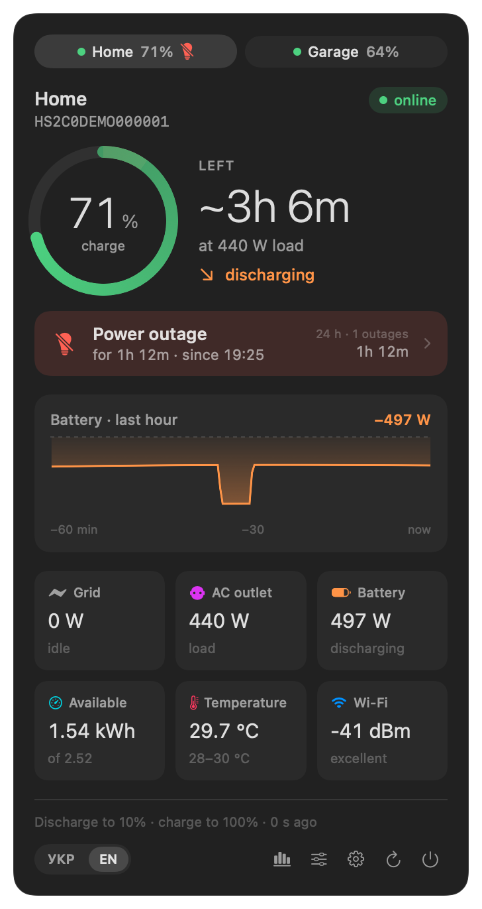
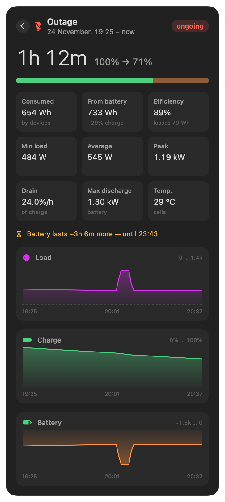
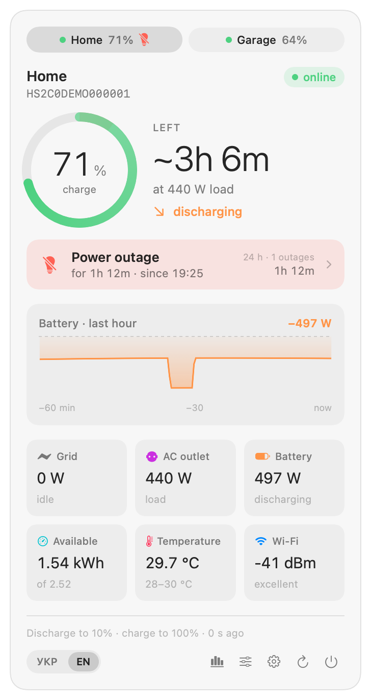
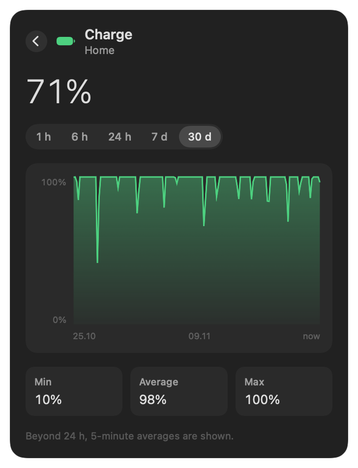
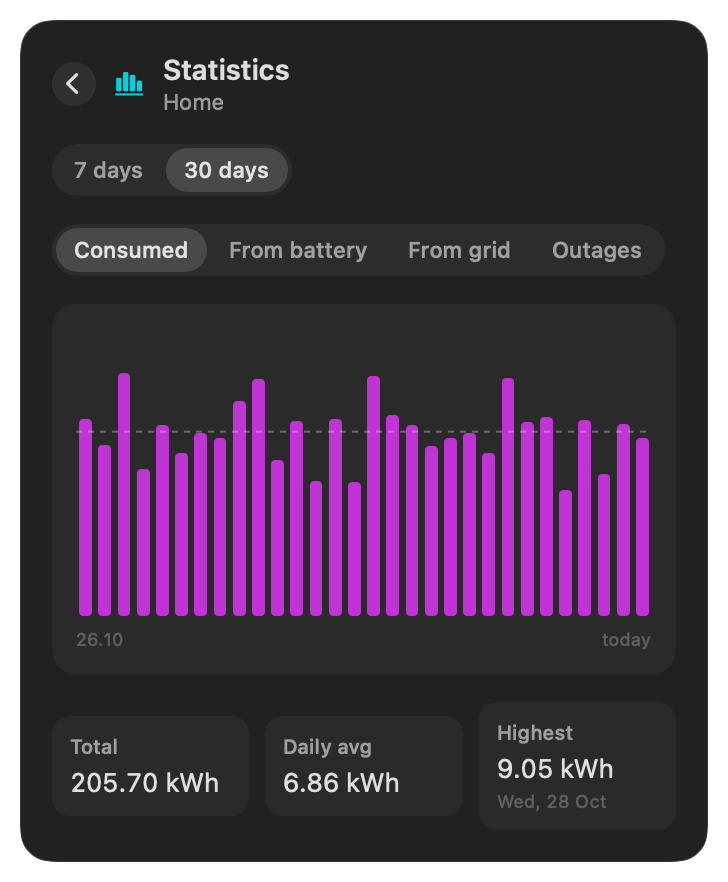
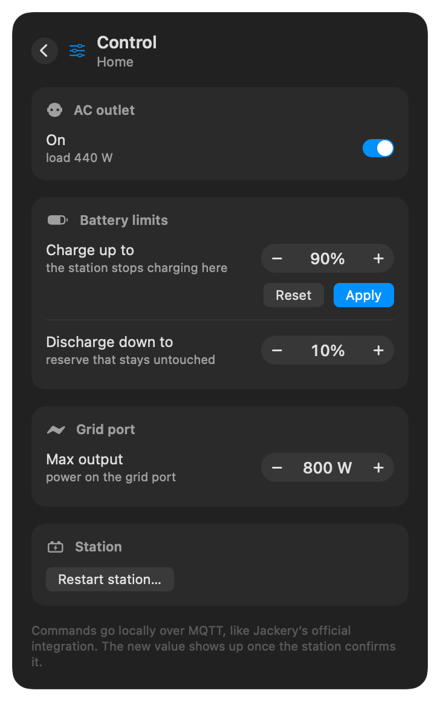
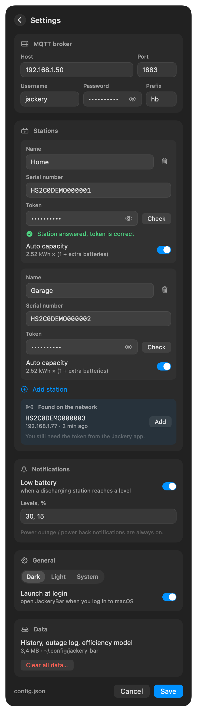

<p align="center">
  <a href="README.md">🇺🇦 Українська</a> · <b>🇬🇧 English</b>
</p>

<h1 align="center">JackeryBar</h1>

<p align="center">
  A macOS menu bar widget for <b>Jackery SolarVault 3</b> home batteries.<br>
  State of charge, how long the battery will last, charts, statistics, a power-outage log and station control.<br>
  Fully local over MQTT, with no Jackery cloud involved.
</p>

<p align="center">
  
</p>

<p align="center">
  
  &nbsp;
  
</p>

> [!NOTE]
> Unofficial project, not affiliated with Jackery. The protocol comes from
> [Jackery's official Home Assistant integration](https://github.com/Jackery-Official/jackery) (MIT).

---

## Contents

- [Features](#features)
- [Screenshots](#screenshots)
- [How it works](#how-it-works)
- [Requirements](#requirements)
- [Installation](#installation)
- [Connecting the station](#connecting-the-station)
- [Configuration](#configuration)
- [Where data is stored](#where-data-is-stored)
- [How runtime is estimated](#how-runtime-is-estimated)
- [Supported devices](#supported-devices)
- [Troubleshooting](#troubleshooting)
- [Development](#development)
- [Credits](#credits)
- [License](#license)

## Features

### Menu bar
- **State of charge** and **runtime left** at the current load, e.g. `CHARGE 73% · LEFT ~5h 10m`. Styled like [Stats](https://github.com/exelban/stats) widgets: a small caption above the value.
- While **charging**, the right column shows the time to full (`TO 100% ~1h 15m`) and the battery icon gets a bolt.
- During a **power outage** the caption changes to `OUTAGE`.
- When the station is offline or the token is wrong, the icon dims.

### Panel (click the widget)
- **Charge ring**, big runtime estimate and the current load.
- **Several stations**: a switcher at the top shows each one's charge and whether it has power. The selected station is the one in the menu bar.
- **Power card**: whether mains power is on, how long it has been out, how many outages there were in the last 24 h.
- **Battery chart for the last hour** and **tiles**: grid, AC outlet, battery (with inverter efficiency), available energy, cell temperature, station Wi‑Fi. A Solar tile appears if the station has PV.
- **УКР | EN** language switch, statistics, control, settings.
- Dark theme by default; light and system themes are available too.

### A chart for every metric
Click any tile to open a detailed chart:
- **1 h / 6 h / 24 h / 7 d / 30 d** ranges;
- exact value and time under the cursor;
- min, average, max, plus energy over the range for power metrics.

### Daily statistics
- Bars for **7 or 30 days**: consumed, discharged by the battery, imported from the grid, hours without power (and solar, if present).
- Total, daily average and the highest day, with a dashed average line.

### Power and outages
- The station reports grid presence itself (`ongridStat`), so outages are detected for real rather than guessed from "0 W".
- **macOS notifications** when power goes out and when it's back.
- **A week at a glance** and **a page for every outage**:
  - charge before → after;
  - how much the devices consumed, how much the battery gave, efficiency and losses;
  - minimum, average and peak load;
  - drain in %/h, temperature;
  - for an ongoing outage: how much longer the battery will last;
  - three charts: load, charge, battery.

### Low-battery alerts
- When a discharging station reaches a level you set (**30% and 15%** by default), you get "Low battery: 15% — the battery lasts ~1h 10m more, until 21:40".
- Each level fires once and re-arms after the station recharges above it.

### Station control
The same local MQTT commands as Jackery's official integration:
- **AC outlet** on/off (turning it off asks for confirmation first);
- **battery limits**: charge up to (50–100%) and discharge down to (5–49%);
- **max output on the grid port** (0–2500 W);
- **restart the station** (with confirmation).

After a command, the widget waits for the station to confirm the new value and warns you if it doesn't.

### Also
- **Station discovery**: a station connects to the broker with its serial number as the client id, and the widget finds it in the Mosquitto log. No need to copy the serial by hand.
- **Token check** right in the settings: "token is correct", "wrong token" or "no answer".
- **Self-learning inverter efficiency**: inverter losses are accounted for in the runtime estimate.
- **History**: detailed points for 24 h and 5-minute averages for a year. The settings show how much disk space the data takes and offer **Clear all data**, with confirmation.
- **Localization**: Ukrainian (default) and English.
- **Everything stays local**: plain JSON files in `~/.config/jackery-bar/`.

## Screenshots

| Panel (light theme) | 30-day chart | Daily statistics |
|:---:|:---:|:---:|
|  |  |  |

| Outages this week | Single outage | Control |
|:---:|:---:|:---:|
|  |  |  |

| Metric chart | Settings |
|:---:|:---:|
|  |  |

Screenshots use demo data (`./scripts/screenshots.sh`).

## How it works

```
┌──────────────────┐   MQTT    ┌──────────────────────┐   MQTT    ┌──────────────┐
│ Jackery          │ ────────▶ │ MQTT broker          │ ◀──────── │ JackeryBar   │
│ SolarVault 3 ×N  │ ◀──────── │ (Mosquitto on a Mac) │ ────────▶ │ (menu bar)   │
└──────────────────┘           └──────────────────────┘           └──────────────┘
```

1. In the Jackery app you point each station at **your own** MQTT broker on the LAN.
2. JackeryBar keeps one broker connection for all stations and asks each for data every 5 seconds: `type 25` and `type 105` requests on `hb/device/<SN>/action`.
3. Stations answer on `hb/device/<SN>/status` and `…/event`. Every request carries the token from the Jackery app. A wrong token gets a 401 error, which the widget shows.
4. Control commands are sent as `type 1 / cmd 5`, like the official integration.

The Jackery cloud isn't needed. The MQTT client is built in (MQTT 3.1.1 on `Network.framework`), with no third-party dependencies.

## Requirements

- macOS 14 Sonoma or later, Apple Silicon or Intel.
- Xcode or the Command Line Tools (`xcode-select --install`) for `swiftc`.
- [Homebrew](https://brew.sh) to install the Mosquitto broker (or any other MQTT broker on your network).
- Jackery app **2.0.0+**, which added the MQTT settings.
- The stations and the Mac on the same local network.

## Installation

```bash
git clone https://github.com/Loony-dev/jackerybar.git
cd jackerybar
./build.sh --install
open ~/Applications/JackeryBar.app
```

`build.sh` builds a universal `.app` (arm64 + x86_64) and signs it ad-hoc. With `--install` it copies the app into `~/Applications` and restarts it. No Xcode project is needed.

## Connecting the station

### 1. MQTT broker

The easiest way is to run Mosquitto on this Mac:

```bash
./scripts/setup-mosquitto.sh
```

The script:
- installs Mosquitto via Homebrew;
- creates user `jackery` with a random password;
- turns on the connection log (station discovery reads it);
- runs the broker as a background service on port 1883;
- prints what to enter in the Jackery app.

An existing broker works too, for example Home Assistant's Mosquitto add-on. Discovery won't work then, so you'll enter the serial by hand.

### 2. Jackery app

**Device → Settings → MQTT**:

| Field | Value |
|---|---|
| Server IP | your Mac's IP (the script prints it) |
| Port | `1883` |
| Username / password | from the script output |

Enable MQTT. The app shows a **token**, which you'll enter in JackeryBar. Each station has its own token.

### 3. JackeryBar

Click the widget → ⚙️ **Settings**:

1. **MQTT broker:** `127.0.0.1` (if the broker runs on this Mac), port, username and password. Click **Save** so the widget connects.
2. **Stations:** in "Found on the network" click **Add** (or type the serial), paste the token and click **Check**.
3. Add more stations with **Add station**.

> [!TIP]
> Reserve this Mac's IP in your router (DHCP reservation). Otherwise the station loses the broker when the address changes.

## Configuration

Everything lives in `~/.config/jackery-bar/config.json`. You'll normally edit it through the settings page, but the file can be edited by hand too:

```json
{
  "host": "127.0.0.1",
  "port": 1883,
  "username": "jackery",
  "password": "…",
  "topicPrefix": "hb",
  "stations": [
    { "deviceSn": "HS2C…", "token": "…", "name": "Home" },
    { "deviceSn": "HS2C…", "token": "…", "name": "Garage", "capacityWh": 5040 }
  ],
  "selected": "HS2C…",
  "language": "en",
  "theme": "dark",
  "lowBattery": { "enabled": true, "thresholds": [30, 15] }
}
```

| Key | Description |
|---|---|
| `host`, `port`, `username`, `password` | MQTT broker |
| `topicPrefix` | topic prefix, default `hb` |
| `stations[]` | `deviceSn` and `token` (required), `name`, `capacityWh` (manual capacity), `moduleWh` (module capacity, default 2520) |
| `selected` | the station shown in the menu bar |
| `language` | `uk` (default) or `en` |
| `theme` | `dark` (default), `light`, `system` |
| `lowBattery` | low-battery alerts: `enabled`, `thresholds` (in %) |
| `smoothingSeconds` | power smoothing for the runtime estimate, default 60 s |

The old single-station format (`deviceSn`/`token` at the top level) is read automatically and rewritten in the new format on the first save.

## Where data is stored

Everything stays in `~/.config/jackery-bar/` and is never sent anywhere. Each station gets its own set of files:

| File | Contents |
|---|---|
| `config.json` | settings (mode `600`) |
| `metrics-<SN>.json` | detailed 24 h history, a point every 5–10 s (≈0.5 MB) |
| `longterm-<SN>.json` | 5-minute averages for a year (≈5 MB per year) |
| `outages-<SN>.json` | 90-day outage log; each outage keeps its own per-minute data |
| `losses-<SN>.json` | samples for the inverter efficiency model |

The data size and a **Clear all data** button are in the settings, under Data. Settings are kept when clearing.

## How runtime is estimated

- **Discharging:** `(charge − discharge limit) × capacity ÷ battery discharge power`. The station reports the discharge limit itself (`socDischgLimit`).
- **Charging:** the menu bar shows the time to the charge limit (`socChgLimit`). The panel also shows the runtime you'd get if power went out now. For that, the outlet load is converted into battery draw with the learned loss model.
- **Loss model:** while the battery alone feeds the load, the widget collects "outlet output / battery output" pairs and fits `battery = k × output + station's own consumption`.
- Power is smoothed over about a minute so the number doesn't jump around. A sharp change in load resets the smoothing.

## Supported devices

| Device | Status |
|---|---|
| Jackery SolarVault 3 Pro Max AC | ✅ tested, including control commands |
| Other SolarVault 3 models (Pro, Pro Max) | 🔶 should work: same protocol as the official integration, untested |
| Explorer / HomePower | ❌ different protocol |

If your model works (or doesn't), please open an issue.

## Troubleshooting

<details>
<summary><b>"Wrong token"</b></summary>

The station answered with error 401. Copy the token from the Jackery app again and click Check in the settings.
</details>

<details>
<summary><b>"Waiting for station" and no data</b></summary>

Check the serial number, and that MQTT is enabled in the Jackery app with the right IP. To see whether the station sends anything at all:
```bash
mosquitto_sub -h 127.0.0.1 -u jackery -P '<password>' -t 'hb/#' -v
```
</details>

<details>
<summary><b>Discovery finds nothing</b></summary>

It reads the Mosquitto log that `scripts/setup-mosquitto.sh` turns on. A station shows up there as soon as it connects to the broker. Toggling MQTT off and on in the Jackery app makes it reconnect.
</details>

<details>
<summary><b>"No broker"</b></summary>

JackeryBar can't connect to the broker. Check `brew services list` (`mosquitto` must be `started`), the host, port, username and password.
</details>

<details>
<summary><b>No data during a power outage</b></summary>

The router and the Mac must run off the station or a UPS, otherwise the local network goes down with the power.
</details>

<details>
<summary><b>Notifications don't show up</b></summary>

System Settings → Notifications → JackeryBar → allow.
</details>

## Development

```
Sources/
  Core/                UI-free logic (Foundation + Network), covered by tests
    Config.swift         config.json, several stations, old-format migration, file paths
    Protocol.swift       topics, requests, control commands
    MQTTClient.swift     MQTT 3.1.1 on Network.framework
    Hub.swift            one connection for all stations: polling, routing, commands, token check
    Station.swift        station state, runtime, pending commands, low-battery levels
    MetricStore.swift    24 h history + a year of 5-minute averages, daily energy
    GridLog.swift        outage detection, outage log, per-outage stats
    LossModel.swift      inverter efficiency model
    Discovery.swift      finds stations in the Mosquitto log
    Format.swift, Lang.swift
  UI/                  SwiftUI/AppKit: menu bar item, window, pages
Tests/main.swift       Core tests
scripts/
  test.sh              build and run the tests
  setup-mosquitto.sh   installs and configures the broker
  screenshots.sh       README screenshots (demo data)
```

- **Tests:** `./scripts/test.sh`, no Xcode needed.
- **Translations** live right in the code as `L("українською", "in English")` pairs.
- **Checking the UI without a station:**
  - `--render-panel out.png dark [en] [metric battery|outages|outage|stats|control|settings]` renders the panel with demo data;
  - `--demo` runs the app with a fake station.

## Credits

- [Jackery-Official/jackery](https://github.com/Jackery-Official/jackery): the official Home Assistant integration and the source of the protocol (MIT).
- [Bigdaddy1990/jackery_solarvault](https://github.com/Bigdaddy1990/jackery_solarvault) and [steinhuegel/ioBroker.jackery-solarvault](https://github.com/steinhuegel/ioBroker.jackery-solarvault): field and model references.
- [Stats](https://github.com/exelban/stats): inspiration for the widget's look.

## License

[MIT](LICENSE)
