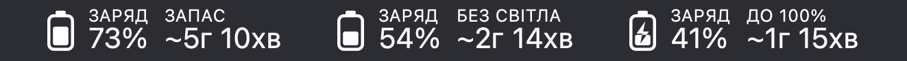
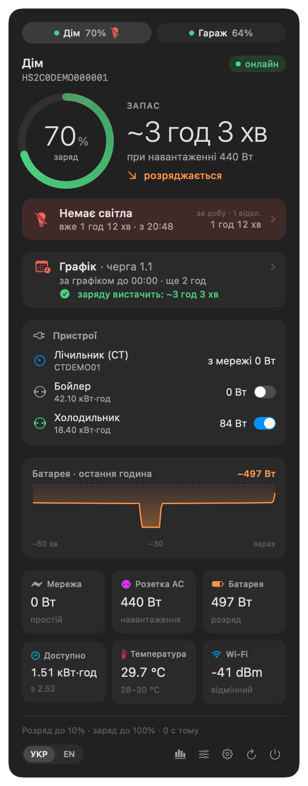
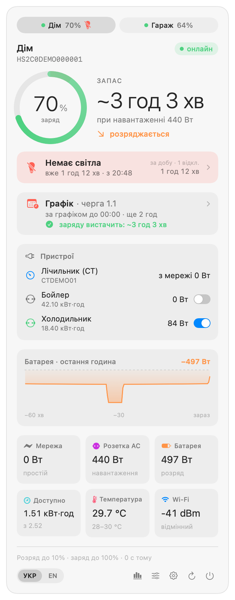
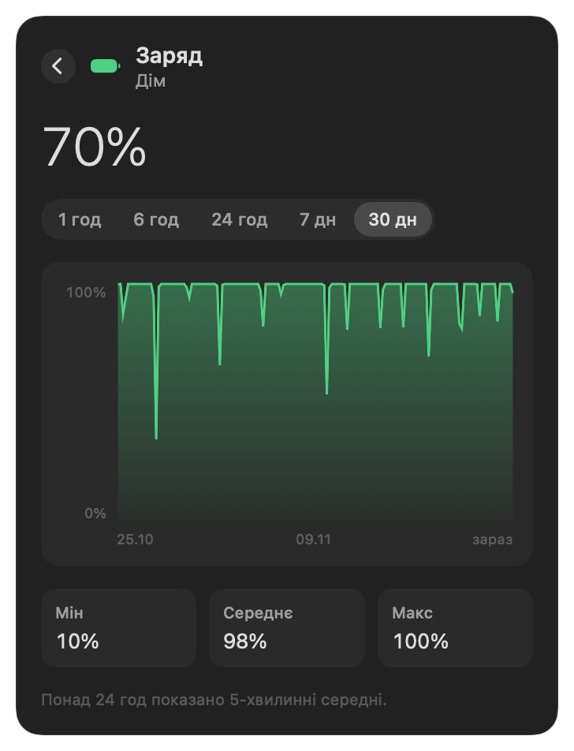
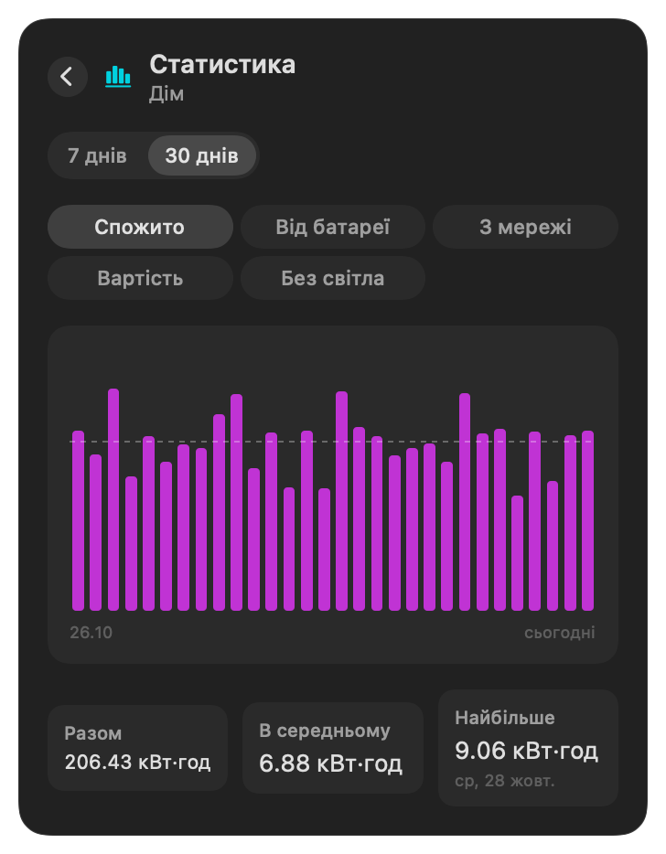
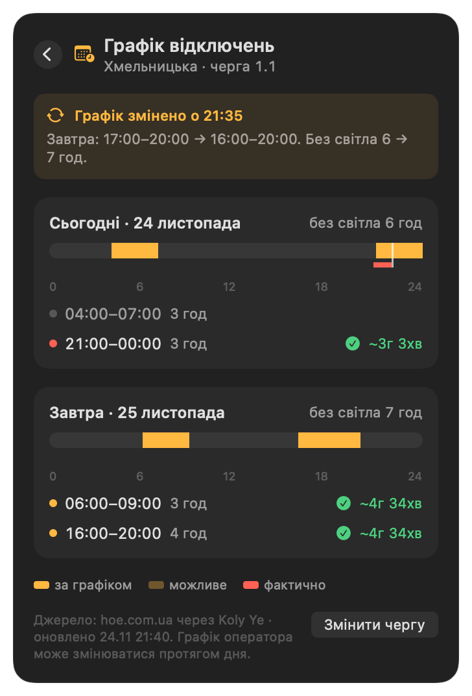
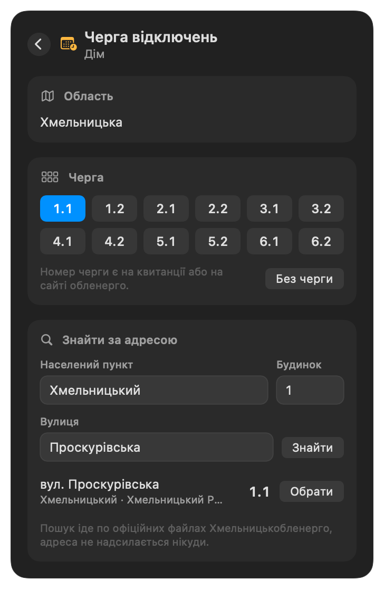
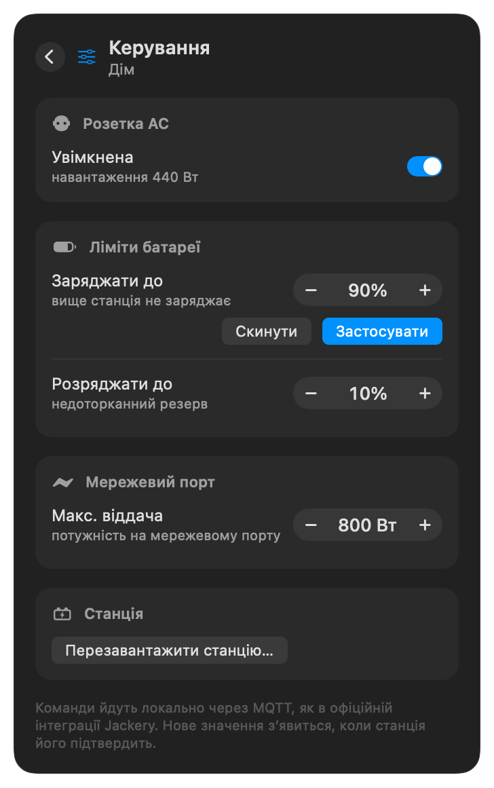

<p align="center">
  <b>🇺🇦 Українська</b> · <a href="README.en.md">🇬🇧 English</a>
</p>

<h1 align="center">JackeryBar</h1>

<p align="center">
  Віджет у рядку меню macOS для домашніх станцій <b>Jackery SolarVault 3</b>.<br>
  Заряд, скільки ще протримається батарея, графіки відключень (ГПВ) з прогнозом заряду, статистика, журнал відключень і керування станцією.<br>
  Працює локально через MQTT, без хмари Jackery.
</p>

<p align="center">
  
</p>

<p align="center">
  
  &nbsp;
  
</p>

> [!NOTE]
> Це неофіційний проєкт, він не пов’язаний із Jackery. Протокол узято з
> [офіційної інтеграції Jackery для Home Assistant](https://github.com/Jackery-Official/jackery) (MIT).

---

## Зміст

- [Можливості](#можливості)
- [Скриншоти](#скриншоти)
- [Як це працює](#як-це-працює)
- [Вимоги](#вимоги)
- [Встановлення](#встановлення)
- [Підключення станції](#підключення-станції)
- [Налаштування](#налаштування)
- [Де зберігаються дані](#де-зберігаються-дані)
- [Як рахується запас](#як-рахується-запас)
- [Підтримувані пристрої](#підтримувані-пристрої)
- [Розв’язання проблем](#розвязання-проблем)
- [Розробка](#розробка)
- [Подяки](#подяки)
- [Ліцензія](#ліцензія)

## Можливості

### Рядок меню
- **Заряд** у відсотках і **запас часу** при поточному навантаженні, наприклад `ЗАРЯД 73% · ЗАПАС ~5г 10хв`. Вигляд як у віджетах [Stats](https://github.com/exelban/stats): маленький підпис над значенням.
- Під час **заряджання** праворуч показано час до повного заряду (`ДО 100% ~1г 15хв`), а на іконці батареї з’являється блискавка.
- Під час **відключення світла** підпис змінюється на `БЕЗ СВІТЛА`.
- Якщо станція не на зв’язку або токен невірний, іконка стає блідою.

### Панель (клік по віджету)
- **Кільце заряду**, великий запас часу та поточне навантаження.
- **Кілька станцій**: перемикач угорі показує заряд кожної і чи є там світло. Обрана станція показується в рядку меню.
- **Картка «Світло»**: чи є світло, скільки його вже немає, скільки відключень було за добу.
- **Графік батареї за останню годину** і **плитки**: мережа, розетка AC, батарея (з ККД інвертора), доступна енергія, температура комірок, Wi‑Fi станції. Якщо є сонячні панелі, з’являється плитка «Сонце».
- Перемикач мови **УКР | EN**, статистика, керування, налаштування.
- Темна тема за замовчуванням, також є світла та системна.

### Графік для кожної метрики
Клік по будь-якій плитці відкриває детальний графік:
- періоди **1 год / 6 год / 24 год / 7 дн / 30 дн**;
- точне значення та час під курсором;
- мінімум, середнє, максимум, а для потужностей ще й енергія за період.

### Статистика по днях
- Стовпчики за **7 або 30 днів**: спожито, віддано батареєю, взято з мережі, **вартість**, години без світла (і сонце, якщо є панелі).
- **Тариф** задається в налаштуваннях: ціна за кВт·год, за бажання двозонний облік (ніч 23:00–7:00).
- Разом, середнє за день і найбільший день. Пунктир показує середнє.

### Світло та відключення
- Станція сама повідомляє, чи є мережа (поле `ongridStat`), тож віджет точно бачить відключення, а не вгадує по «0 Вт».
- **Сповіщення macOS**, коли світло зникло і коли з’явилося.
- **Тиждень на одному екрані** і **окрема сторінка для кожного відключення**:
  - заряд «було → стало»;
  - скільки спожили прилади, скільки віддала батарея, ККД і втрати;
  - мінімальне, середнє та пікове навантаження;
  - витрата заряду в %/год, температура;
  - для поточного відключення: на скільки ще вистачить батареї;
  - три графіки: навантаження, заряд, батарея.

### Графік відключень (ГПВ)
- Графік погодинних відключень **для твоєї черги** на сьогодні й завтра. Дані беруться з [Koly Ye](https://github.com/vkardin/koly) (20 областей).
- **Для Хмельниччини віджет читає пости hoe.com.ua напряму** і сам застосовує оновлення протягом дня («Додаткові години…», «оновлено з 20:00»). Саме на таких оновленнях сторонні сервіси помиляються. Koly та [khm_outage_parser](https://github.com/frankov-dev/khm_outage_parser) лишаються запасними джерелами і для звірки.
- **Картка «Графік»** на головній: наступне відключення («16:00–20:00 · через 2 год 10 хв») і відразу оцінка, **чи вистачить заряду**.
- **Прогноз по всьому графіку**: між відключеннями станція заряджається, під час відключень розряджається з поточним навантаженням. Тож прогноз на завтра враховує сьогоднішні відключення.
- **Сторінка графіка**: смуга на 24 години для кожного дня, план (жовтим) поверх фактичних відключень зі станції (червоним), список інтервалів з прогнозом.
- **Сповіщення заздалегідь** (типово за 30 хв): «Через 30 хв відключення за графіком, 16:00–20:00. Заряд ~86% — вистачить на ~5 год».
- **Сповіщення про зміну графіка** з тим, що саме змінилося: «Сьогодні: 19:00–22:00 → 18:00–22:00; додано 23:00–24:00. Без світла 6 → 8 год». Окремо — коли опублікували графік на завтра. Якщо за новим графіком заряду не вистачить, у сповіщенні буде попередження. Остання зміна видна й на сторінці графіка.
- **Звірка джерел** для Хмельниччини: якщо джерела розходяться щодо твоєї черги, віджет показує всі версії й кнопку на сайт обленерго.
- **Аварійні відключення (ГАВ):** сповіщення, коли оператор оголошує аварійний режим і графіки можуть не діяти, і коли його скасовують.
- **Графік vs факт** за тиждень: скільки годин було за графіком і фактично, відсоток збігу, на скільки хвилин раніше чи пізніше реально вимикали й вмикали світло, скільки було відключень поза графіком.
- **Черга за адресою** для Хмельниччини: пошук по офіційних XLSX-файлах Хмельницькобленерго («населений пункт / вулиця / будинок»). Файли завантажуються один раз, адреса нікуди не надсилається.
- Черга обирається прямо з картки «Графік»: якщо вона ще не вказана, картка відкриває вибір черги. Для кожної станції своя черга.

### Розумна зарядка
- Якщо за прогнозом з поточним лімітом заряду батареї не вистачить на найближче відключення, віджет заздалегідь піднімає ліміт заряду до 100%, а після відключення повертає попередній.
- Вмикається окремо в налаштуваннях (за замовчуванням вимкнено), бо змінює налаштування станції. Про кожну зміну приходить сповіщення. Якщо ти сам змінив ліміт, віджет більше не втручається.

### Сповіщення
- Усі сповіщення можна **дублювати в Telegram** через власного бота: токен від @BotFather, кнопка «Знайти» сама визначає chat id, кнопка «Тест» перевіряє.
- Кнопка **«Надіслати тестові сповіщення»** показує по одному сповіщенню кожного типу.

### Сповіщення про низький заряд
- Коли станція розряджається до заданого порогу (типово **30% і 15%**), приходить сповіщення «Низький заряд: 15% — батареї вистачить ще на ~1 год 10 хв, до 21:40».
- Кожен поріг спрацьовує один раз і знову «зводиться», коли станція підзарядиться вище нього.

### Керування станцією
Ті самі локальні MQTT-команди, що й в офіційній інтеграції Jackery:
- **розетка AC**: увімкнути або вимкнути (вимкнення лише після підтвердження);
- **ліміти заряду**: «заряджати до» (50–100%) і «розряджати до» (5–49%);
- **макс. віддача на мережевому порту** (0–2500 Вт);
- **перезавантаження станції** (після підтвердження).

Після команди віджет чекає, поки станція підтвердить нове значення, а якщо не підтвердить, попереджає.

### Розумні розетки та лічильник
- Якщо до станції під’єднано розумні розетки Jackery або CT-лічильник, на головній з’являється блок «Пристрої»: потужність кожної розетки, перемикач (для розеток у локальному режимі) і потоки з/у мережу з лічильника.

### Інше
- **Автопошук станцій**: станція підключається до брокера з власним серійним номером як client id, і віджет знаходить її в лозі Mosquitto. Номер не треба переписувати вручну.
- **Перевірка токена** прямо в налаштуваннях: «токен вірний», «невірний токен» або «станція не відповіла».
- **Самонавчання ККД інвертора**: втрати інвертора враховуються в оцінці запасу.
- **Історія**: детальні точки за 24 год і 5-хвилинні середні за рік. У налаштуваннях видно, скільки місця займають дані, є **«Експорт у CSV»** (історія, підсумки по днях, відключення в «Завантаження») і **«Очистити всі дані»** з підтвердженням.
- **Локалізація**: українська (за замовчуванням) та англійська.
- **Усе локально**: звичайні JSON-файли в `~/.config/jackery-bar/`.

## Скриншоти

| Панель (світла тема) | Графік за 30 днів | Статистика по днях |
|:---:|:---:|:---:|
|  |  |  |

| Графік відключень | Черга за адресою | Керування |
|:---:|:---:|:---:|
|  |  |  |

| Відключення за тиждень | Одне відключення |
|:---:|:---:|
|  |  |

| Графік метрики | Налаштування |
|:---:|:---:|
|  |  |

Скриншоти зроблено на демо-даних (`./scripts/screenshots.sh`).

## Як це працює

```
┌──────────────────┐   MQTT    ┌──────────────────────┐   MQTT    ┌──────────────┐
│ Jackery          │ ────────▶ │ MQTT-брокер          │ ◀──────── │ JackeryBar   │
│ SolarVault 3 ×N  │ ◀──────── │ (Mosquitto на Mac)   │ ────────▶ │ (рядок меню) │
└──────────────────┘           └──────────────────────┘           └──────────────┘
```

1. У застосунку Jackery станція підключається до **вашого** MQTT-брокера в локальній мережі.
2. JackeryBar тримає одне підключення до брокера для всіх станцій і кожні 5 секунд просить кожну надіслати дані: запити `type 25` і `type 105` у `hb/device/<SN>/action`.
3. Станції відповідають у `hb/device/<SN>/status` та `…/event`. Кожен запит містить токен із застосунку Jackery. На невірний токен станція відповідає помилкою 401, і віджет це показує.
4. Команди керування надсилаються як `type 1 / cmd 5` (як в офіційній інтеграції).

Хмара Jackery не потрібна. MQTT-клієнт вбудований (MQTT 3.1.1 поверх `Network.framework`), сторонніх залежностей немає.

## Вимоги

- macOS 14 Sonoma або новіша, Apple Silicon або Intel.
- Xcode або Command Line Tools (`xcode-select --install`): потрібен `swiftc`.
- [Homebrew](https://brew.sh), щоб поставити брокер Mosquitto (або будь-який інший MQTT-брокер у мережі).
- Застосунок Jackery **версії 2.0.0+**: у ньому з’явилися налаштування MQTT.
- Станції та Mac в одній локальній мережі.

## Встановлення

```bash
git clone https://github.com/Loony-dev/jackerybar.git
cd jackerybar
./build.sh --install
open ~/Applications/JackeryBar.app
```

`build.sh` збирає універсальний `.app` (arm64 + x86_64) і підписує його ad-hoc. З `--install` копіює застосунок у `~/Applications` і перезапускає. Xcode-проєкт не потрібен.

## Підключення станції

### 1. MQTT-брокер

Найпростіше запустити Mosquitto прямо на цьому Mac:

```bash
./scripts/setup-mosquitto.sh
```

Скрипт:
- встановлює Mosquitto через Homebrew;
- створює користувача `jackery` з випадковим паролем;
- вмикає лог підключень (з нього працює автопошук станцій);
- запускає брокер як фонову службу на порту 1883;
- друкує, що вписати в застосунок Jackery.

Можна використати й наявний брокер, наприклад Mosquitto з Home Assistant. Тоді автопошук не працюватиме, і серійний номер доведеться ввести вручну.

### 2. Застосунок Jackery

**Пристрій → Налаштування → MQTT**:

| Поле | Значення |
|---|---|
| IP сервера | IP вашого Mac (скрипт його покаже) |
| Порт | `1883` |
| Логін / пароль | з виводу скрипта |

Увімкніть MQTT. Застосунок покаже **токен**, його знадобиться ввести в JackeryBar. Для кожної станції токен свій.

### 3. JackeryBar

Клікніть по віджету → ⚙️ **Налаштування**:

1. **MQTT-брокер:** `127.0.0.1` (якщо брокер на цьому Mac), порт, логін і пароль. Натисніть **Зберегти**, щоб віджет підключився.
2. **Станції:** у блоці «Знайдено в мережі» натисніть **Додати** (або введіть серійний номер вручну), вставте токен і натисніть **Перевірити**.
3. Друга і наступні станції додаються кнопкою **«Додати станцію»**.

> [!TIP]
> Закріпіть IP цього Mac у налаштуваннях роутера (DHCP reservation). Інакше після зміни адреси станція «загубить» брокер.

## Налаштування

Усе зберігається в `~/.config/jackery-bar/config.json`. Зазвичай його редагують через панель налаштувань, але файл можна правити й вручну:

```json
{
  "host": "127.0.0.1",
  "port": 1883,
  "username": "jackery",
  "password": "…",
  "topicPrefix": "hb",
  "stations": [
    { "deviceSn": "HS2C…", "token": "…", "name": "Дім", "region": "khmelnytskyi", "queue": "1.1" },
    { "deviceSn": "HS2C…", "token": "…", "name": "Гараж", "capacityWh": 5040 }
  ],
  "selected": "HS2C…",
  "language": "uk",
  "theme": "dark",
  "lowBattery": { "enabled": true, "thresholds": [30, 15] },
  "planAlerts": { "enabled": true, "minutesBefore": 30 },
  "smartCharge": { "enabled": false, "lookaheadHours": 6 },
  "telegram": { "enabled": true, "token": "…", "chatId": "…" },
  "tariff": { "day": 4.32, "night": 2.16 }
}
```

| Поле | Опис |
|---|---|
| `host`, `port`, `username`, `password` | MQTT-брокер |
| `topicPrefix` | префікс топіків, за замовчуванням `hb` |
| `stations[]` | `deviceSn` і `token` (обов’язково), `name`, `capacityWh` (ємність вручну), `moduleWh` (ємність модуля, за замовчуванням 2520), `region` і `queue` (черга ГПВ, напр. `khmelnytskyi` / `1.1`) |
| `selected` | станція, яку показує рядок меню |
| `language` | `uk` (за замовчуванням) або `en` |
| `theme` | `dark` (за замовчуванням), `light`, `system` |
| `lowBattery` | сповіщення про низький заряд: `enabled`, `thresholds` (у %) |
| `planAlerts` | сповіщення перед відключенням за графіком: `enabled`, `minutesBefore`, `changes` (про зміну графіка) |
| `smartCharge` | розумна зарядка: `enabled`, `lookaheadHours` |
| `telegram` | `enabled`, `token` бота, `chatId` |
| `tariff` | `day` (ціна за кВт·год), `night` (нічна ціна, якщо двозонний облік), `nightFrom`/`nightTo`, `currency` |
| `smoothingSeconds` | згладжування потужності для оцінки запасу, за замовчуванням 60 с |

Старий формат з однією станцією (`deviceSn`/`token` у корені) читається автоматично і переписується в новий при першому збереженні.

## Де зберігаються дані

Усе в `~/.config/jackery-bar/`, нікуди не надсилається. Для кожної станції окремий набір файлів:

| Файл | Що в ньому |
|---|---|
| `config.json` | налаштування (права `600`) |
| `metrics-<SN>.json` | детальна історія за 24 год, точка кожні 5–10 с (≈0,5 МБ) |
| `longterm-<SN>.json` | 5-хвилинні середні за рік (≈5 МБ за рік) |
| `outages-<SN>.json` | журнал відключень за 90 днів, для кожного зберігаються хвилинні дані |
| `losses-<SN>.json` | заміри для моделі ККД інвертора |
| `schedule-<регіон>.json` | остання копія графіка відключень (щоб працювало й без інтернету) |
| `plans-<SN>.json` | графік твоєї черги по днях за 90 днів (для «Графік vs факт») |
| `smartcharge-<SN>.json` | поки розумна зарядка підняла ліміт: який був до неї |
| `addresses-khmelnytskyi.json` | розібрані файли «адреса → черга» Хмельницькобленерго (~3 МБ, оновлюються раз на тиждень) |

Розмір даних і кнопка **«Очистити всі дані»** є в налаштуваннях, у блоці «Дані». Налаштування при очищенні залишаються.

## Як рахується запас

- **Розряд:** `(заряд − поріг розряду) × ємність ÷ потужність розряду батареї`. Поріг розряду (`socDischgLimit`) станція повідомляє сама.
- **Заряджання:** у рядку меню показано час до ліміту заряду (`socChgLimit`). У панелі також видно запас, якщо зараз зникне світло. Для нього навантаження на розетці перераховується у витрату батареї через вивчену модель втрат.
- **Модель втрат:** поки батарея сама живить навантаження, віджет збирає пари «вихід на розетці / віддача батареї» і будує з них `батарея = k × вихід + власне споживання`.
- Потужність згладжується приблизно за хвилину, щоб цифра не стрибала. Якщо навантаження різко змінилося, згладжування скидається.

## Підтримувані пристрої

| Пристрій | Статус |
|---|---|
| Jackery SolarVault 3 Pro Max AC | ✅ перевірено, включно з командами керування |
| Інші SolarVault 3 (Pro, Pro Max) | 🔶 мають працювати: той самий протокол офіційної інтеграції, не перевірено |
| Explorer / HomePower | ❌ інший протокол |

Якщо ваша модель працює (або ні), відкрийте issue, будь ласка.

## Розв’язання проблем

<details>
<summary><b>«Невірний токен»</b></summary>

Станція відповіла помилкою 401. Скопіюйте токен із застосунку Jackery ще раз і натисніть «Перевірити» в налаштуваннях.
</details>

<details>
<summary><b>«Чекаємо станцію» і даних немає</b></summary>

Перевірте серійний номер і що MQTT у застосунку Jackery увімкнено з правильним IP. Подивитися, чи станція взагалі щось надсилає:
```bash
mosquitto_sub -h 127.0.0.1 -u jackery -P '<пароль>' -t 'hb/#' -v
```
</details>

<details>
<summary><b>Автопошук нічого не знаходить</b></summary>

Він читає лог Mosquitto, який вмикає `scripts/setup-mosquitto.sh`. Станція з’являється там, щойно підключиться до брокера: можна вимкнути й увімкнути MQTT у застосунку Jackery.
</details>

<details>
<summary><b>«Немає брокера»</b></summary>

JackeryBar не може підключитися до брокера. Перевірте `brew services list` (служба `mosquitto` має бути `started`), адресу, порт, логін і пароль.
</details>

<details>
<summary><b>Під час відключення світла даних немає</b></summary>

Роутер і Mac мають працювати від станції або від ДБЖ, інакше локальна мережа зникає разом зі світлом.
</details>

<details>
<summary><b>Не приходять сповіщення</b></summary>

Системні налаштування → Сповіщення → JackeryBar → дозволити.
</details>

## Розробка

```
Sources/
  Core/                логіка без UI (Foundation + Network), покрита тестами
    Config.swift         config.json, кілька станцій, міграція старого формату, шляхи до файлів
    Protocol.swift       топіки, запити, команди керування
    MQTTClient.swift     MQTT 3.1.1 поверх Network.framework
    Hub.swift            одне підключення на всі станції: опитування, маршрутизація, команди, перевірка токена
    Station.swift        стан станції, запас, команди в очікуванні, пороги заряду
    MetricStore.swift    історія 24 год + 5-хвилинні середні за рік, енергія по днях
    GridLog.swift        виявлення відключень, журнал, статистика відключення
    LossModel.swift      модель ККД інвертора
    Discovery.swift      пошук станцій у лозі Mosquitto
    Schedule*.swift      графіки відключень (Koly / hoe.com.ua), прогноз заряду, зміни графіка, звірка джерел
    HoeParser.swift      розбір постів hoe.com.ua з оновленнями протягом дня
    PlanAccuracy.swift   графік vs факт
    Telegram.swift       сповіщення в Telegram
    Export.swift         експорт у CSV
    AddressBook.swift    черга за адресою з XLSX Хмельницькобленерго
    Format.swift, Lang.swift
  UI/                  SwiftUI/AppKit: рядок меню, вікно, сторінки
Tests/main.swift       тести Core
scripts/
  test.sh              зібрати й запустити тести
  setup-mosquitto.sh   встановлення та налаштування брокера
  screenshots.sh       скриншоти для README (демо-дані)
```

- **Тести:** `./scripts/test.sh`, Xcode не потрібен.
- **Переклади** пишуться прямо в коді парою `L("українською", "in English")`.
- **Перевірка вигляду без станції:**
  - `--render-panel out.png dark [en] [metric battery|outages|outage|stats|control|settings]` рендерить панель на демо-даних;
  - `--demo` запускає застосунок із фейковою станцією.

## Подяки

- [Jackery-Official/jackery](https://github.com/Jackery-Official/jackery): офіційна інтеграція для Home Assistant, джерело протоколу (MIT).
- [Bigdaddy1990/jackery_solarvault](https://github.com/Bigdaddy1990/jackery_solarvault) та [steinhuegel/ioBroker.jackery-solarvault](https://github.com/steinhuegel/ioBroker.jackery-solarvault): опис полів і моделей.
- [Koly Ye](https://github.com/vkardin/koly) (MIT): нормалізовані графіки відключень по областях.
- [khm_outage_parser](https://github.com/frankov-dev/khm_outage_parser): графіки Хмельниччини (запасне джерело).
- [fastiuk/ukraine-energy-monitor](https://github.com/fastiuk/ukraine-energy-monitor): огляд джерел графіків по всіх обленерго.
- [Stats](https://github.com/exelban/stats): натхнення для вигляду віджета.

## Ліцензія

[MIT](LICENSE)
