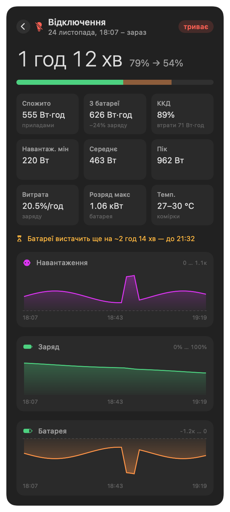
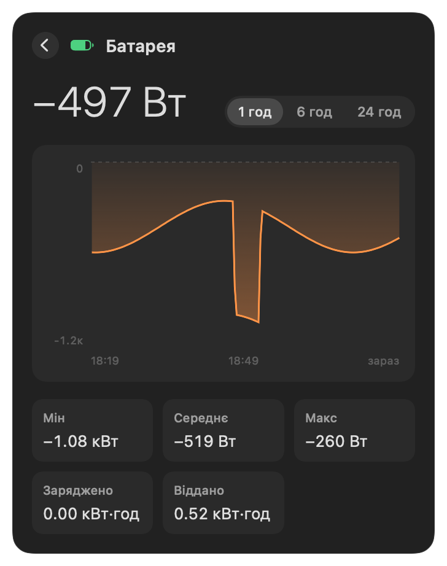
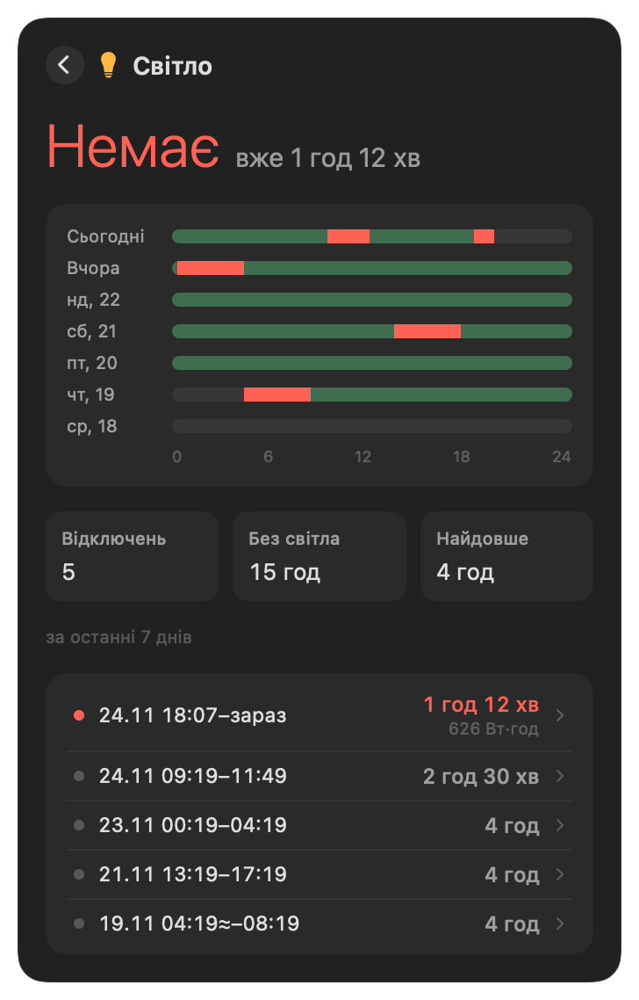
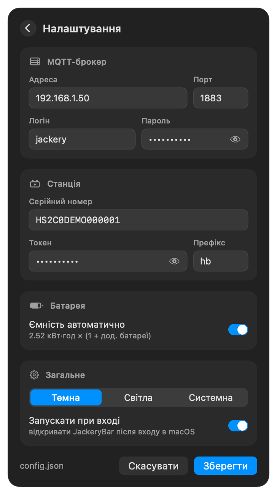

<p align="center">
  <b>🇺🇦 Українська</b> · <a href="README.en.md">🇬🇧 English</a>
</p>

<h1 align="center">JackeryBar</h1>

<p align="center">
  Віджет у рядку меню macOS для домашніх станцій <b>Jackery SolarVault 3</b>.<br>
  Заряд, скільки ще протримається батарея, графіки та журнал відключень світла.<br>
  Працює локально через MQTT, без хмари Jackery.
</p>

<p align="center">
  
</p>

<p align="center">
  
  &nbsp;
  
</p>

> [!NOTE]
> Це неофіційний проєкт, він не пов’язаний із Jackery. Протокол узято з
> [офіційної інтеграції Jackery для Home Assistant](https://github.com/Jackery-Official/jackery) (MIT).

---

## Зміст

- [Можливості](#можливості)
- [Скриншоти](#скриншоти)
- [Як це працює](#як-це-працює)
- [Вимоги](#вимоги)
- [Встановлення](#встановлення)
- [Підключення станції](#підключення-станції)
- [Налаштування](#налаштування)
- [Де зберігаються дані](#де-зберігаються-дані)
- [Як рахується запас](#як-рахується-запас)
- [Підтримувані пристрої](#підтримувані-пристрої)
- [Розв’язання проблем](#розвязання-проблем)
- [Розробка](#розробка)
- [Подяки](#подяки)
- [Ліцензія](#ліцензія)

## Можливості

### Рядок меню
- **Заряд** у відсотках і **запас часу** при поточному навантаженні, наприклад `ЗАРЯД 73% · ЗАПАС ~5г 10хв`. Вигляд як у віджетах [Stats](https://github.com/exelban/stats): маленький підпис над значенням.
- Під час **заряджання** праворуч показано час до повного заряду (`ДО 100% ~1г 15хв`), а на іконці батареї з’являється блискавка.
- Під час **відключення світла** підпис змінюється на `БЕЗ СВІТЛА`.
- Іконка батареї заповнюється відповідно до рівня заряду. Якщо станція не на зв’язку, іконка стає блідою.

### Панель (клік по віджету)
- **Кільце заряду** (зелене, жовте чи червоне залежно від рівня), великий запас часу та поточне навантаження.
- **Картка «Світло»**: чи є світло, скільки його вже немає та скільки відключень було за добу.
- **Графік батареї за останню годину**: заряд зеленим, розряд помаранчевим.
- **Плитки**: мережа, розетка AC, батарея (з ККД інвертора), доступна енергія, температура комірок, Wi‑Fi станції. Якщо на станції є сонячні панелі, з’являється плитка «Сонце».
- Перемикач мови **УКР | EN**, налаштування, перепідключення.
- Темна тема за замовчуванням, також є світла та системна.

### Графік для кожної метрики
Клік по будь-якій плитці відкриває детальний графік:
- періоди **1 год / 6 год / 24 год**;
- точне значення та час під курсором;
- **мінімум, середнє, максимум**, а для потужностей ще й енергія за період (заряджено/віддано, з мережі/у мережу, спожито).

### Світло та відключення
- Станція сама повідомляє, чи є мережа (поле `ongridStat`), тож віджет точно бачить відключення, а не вгадує по «0 Вт».
- **Сповіщення macOS**, коли світло зникло («Станція на батареї: заряд 77%, вистачить на ~5 год 10 хв») і коли з’явилося («Світла не було 2 год 14 хв»).
- **Тиждень на одному екрані**: стрічка по днях із відключеннями червоним, кількість відключень, загальний час без світла, найдовше відключення.
- **Окрема сторінка для кожного відключення**:
  - заряд «було → стало»;
  - скільки спожили прилади, скільки віддала батарея, ККД і втрати;
  - мінімальне, середнє та пікове навантаження;
  - витрата заряду в %/год, температура;
  - для поточного відключення: на скільки ще вистачить батареї;
  - три графіки: навантаження, заряд, батарея.

### Інше
- **Самонавчання ККД інвертора**: віджет запам’ятовує, скільки батарея віддає на кожен ват на розетці, і враховує втрати в оцінці запасу.
- **Налаштування прямо в панелі**: брокер, станція, ємність, тема, автозапуск.
- **Локалізація**: українська (за замовчуванням) та англійська.
- **Усе локально**: історія метрик за 24 год, журнал відключень за 90 днів, звичайні JSON-файли.

## Скриншоти

| Панель (світла тема) | Графік метрики | Відключення за тиждень |
|:---:|:---:|:---:|
|  |  |  |

| Одне відключення | Налаштування |
|:---:|:---:|
|  |  |

Скриншоти зроблено на демо-даних (`./scripts/screenshots.sh`).

## Як це працює

```
┌──────────────────┐   MQTT    ┌──────────────────────┐   MQTT    ┌──────────────┐
│ Jackery          │ ────────▶ │ MQTT-брокер          │ ◀──────── │ JackeryBar   │
│ SolarVault 3     │ ◀──────── │ (Mosquitto на Mac)   │ ────────▶ │ (рядок меню) │
└──────────────────┘           └──────────────────────┘           └──────────────┘
```

1. У застосунку Jackery станція підключається до **вашого** MQTT-брокера в локальній мережі.
2. JackeryBar підключається до того самого брокера і кожні 5 секунд просить станцію надіслати дані: запити `type 25` (стан пристрою) і `type 105` (повні дані системи) у топік `hb/device/<SN>/action`.
3. Станція відповідає в `hb/device/<SN>/status` та `…/event`. Кожен запит містить токен, який видає застосунок Jackery.

Хмара Jackery для роботи не потрібна. MQTT-клієнт вбудований (MQTT 3.1.1 поверх `Network.framework`), сторонніх залежностей немає.

## Вимоги

- macOS 14 Sonoma або новіша, Apple Silicon або Intel.
- Xcode або Command Line Tools (`xcode-select --install`): потрібен `swiftc`.
- [Homebrew](https://brew.sh), щоб поставити брокер Mosquitto (або будь-який інший MQTT-брокер у мережі).
- Застосунок Jackery **версії 2.0.0+**: у ньому з’явилися налаштування MQTT.
- Станція та Mac в одній локальній мережі.

## Встановлення

```bash
git clone https://github.com/Loony-dev/jackerybar.git
cd jackerybar
./build.sh --install
open ~/Applications/JackeryBar.app
```

`build.sh` збирає універсальний `.app` (arm64 + x86_64) і підписує його ad-hoc. З `--install` копіює застосунок у `~/Applications` і перезапускає. Xcode-проєкт не потрібен.

## Підключення станції

### 1. MQTT-брокер

Найпростіше запустити Mosquitto прямо на цьому Mac:

```bash
./scripts/setup-mosquitto.sh
```

Скрипт:
- встановлює Mosquitto через Homebrew;
- створює користувача `jackery` з випадковим паролем;
- вмикає брокер як фонову службу на порту 1883;
- друкує, що вписати в застосунок Jackery.

Можна використати й наявний брокер, наприклад Mosquitto з Home Assistant.

### 2. Застосунок Jackery

**Пристрій → Налаштування → MQTT**:

| Поле | Значення |
|---|---|
| IP сервера | IP вашого Mac (скрипт його покаже) |
| Порт | `1883` |
| Логін / пароль | з виводу скрипта |

Увімкніть MQTT. Застосунок покаже **токен**, його знадобиться ввести в JackeryBar. Серійний номер станції є в інформації про пристрій.

### 3. JackeryBar

Клікніть по віджету → ⚙️ **Налаштування** і заповніть:

- **MQTT-брокер:** `127.0.0.1` (якщо брокер на цьому Mac), порт, логін і пароль;
- **Станція:** серійний номер і токен.

Натисніть **Зберегти**. Через кілька секунд з’являться дані.

> [!TIP]
> Закріпіть IP цього Mac у налаштуваннях роутера (DHCP reservation). Інакше після зміни адреси станція «загубить» брокер.

## Налаштування

Усе зберігається в `~/.config/jackery-bar/config.json`. Зазвичай його редагують через панель налаштувань, але файл можна правити й вручну:

```json
{
  "host": "127.0.0.1",
  "port": 1883,
  "username": "jackery",
  "password": "…",
  "deviceSn": "HS2C…",
  "token": "…",
  "topicPrefix": "hb",
  "language": "uk",
  "theme": "dark",
  "moduleWh": 2520,
  "capacityWh": 5040,
  "name": "Jackery SolarVault 3 Pro Max AC",
  "smoothingSeconds": 60
}
```

| Поле | Опис |
|---|---|
| `host`, `port`, `username`, `password` | MQTT-брокер |
| `deviceSn`, `token` | серійний номер станції та токен із застосунку Jackery |
| `topicPrefix` | префікс топіків, за замовчуванням `hb` |
| `language` | `uk` (за замовчуванням) або `en` |
| `theme` | `dark` (за замовчуванням), `light`, `system` |
| `moduleWh` | ємність одного модуля, за замовчуванням 2520 Вт·год |
| `capacityWh` | загальна ємність вручну. Якщо не задано: `moduleWh × (1 + дод. батареї)` |
| `name` | назва в шапці панелі |
| `smoothingSeconds` | згладжування потужності для оцінки запасу, за замовчуванням 60 с |

## Де зберігаються дані

Усе в `~/.config/jackery-bar/`, нікуди не надсилається:

| Файл | Що в ньому |
|---|---|
| `config.json` | налаштування (права `600`) |
| `metrics-<SN>.json` | історія всіх метрик за 24 год, точка кожні 5–10 с (≈0,5 МБ/добу) |
| `outages-<SN>.json` | журнал відключень за 90 днів, для кожного зберігаються хвилинні дані |
| `losses-<SN>.json` | заміри для моделі ККД інвертора |

## Як рахується запас

- **Розряд:** `(заряд − поріг розряду) × ємність ÷ потужність розряду батареї`. Поріг розряду (`socDischgLimit`) станція повідомляє сама.
- **Заряджання:** у рядку меню показано час до ліміту заряду (`socChgLimit`). У панелі також видно запас, якщо зараз зникне світло. Для нього навантаження на розетці перераховується у витрату батареї через вивчену модель втрат.
- **Модель втрат:** поки батарея сама живить навантаження, віджет збирає пари «вихід на розетці / віддача батареї». Із них виходить `батарея = k × вихід + власне споживання`. Поки навантаження однакове, використовується просте співвідношення (типово ККД ≈ 90%).
- Потужність згладжується приблизно за хвилину, щоб цифра не стрибала. Якщо навантаження різко змінилося, згладжування скидається.

## Підтримувані пристрої

| Пристрій | Статус |
|---|---|
| Jackery SolarVault 3 Pro Max AC | ✅ перевірено |
| Інші SolarVault 3 (Pro, Pro Max) | 🔶 мають працювати: той самий протокол офіційної інтеграції, не перевірено |
| Explorer / HomePower | ❌ інший протокол |

Якщо ваша модель працює (або ні), відкрийте issue, будь ласка.

## Розв’язання проблем

<details>
<summary><b>«Чекаємо станцію» і даних немає</b></summary>

Станція мовчки ігнорує запити з неправильним токеном. Перевірте серійний номер і токен. Якщо ви змінювали налаштування MQTT у застосунку Jackery, звірте токен ще раз.

Перевірити, чи станція взагалі щось надсилає:
```bash
mosquitto_sub -h 127.0.0.1 -u jackery -P '<пароль>' -t 'hb/#' -v
```
</details>

<details>
<summary><b>«Немає брокера»</b></summary>

JackeryBar не може підключитися до брокера. Перевірте `brew services list` (служба `mosquitto` має бути `started`), адресу, порт, логін і пароль.
</details>

<details>
<summary><b>Після зміни IP Mac усе зламалося</b></summary>

Станція підключається до IP, вказаного в застосунку Jackery. Закріпіть IP за Mac у роутері або оновіть його в застосунку Jackery.
</details>

<details>
<summary><b>Під час відключення світла даних немає</b></summary>

Роутер і Mac мають працювати від станції або від ДБЖ, інакше локальна мережа зникає разом зі світлом.
</details>

<details>
<summary><b>Не приходять сповіщення</b></summary>

Системні налаштування → Сповіщення → JackeryBar → дозволити.
</details>

## Розробка

```
Sources/
  main.swift          конфіг, MQTT-клієнт, модель станції, рядок меню, AppDelegate
  Panel.swift         головна панель, плитки, футер
  Metrics.swift       історія метрик (JSON), графіки, сторінка метрики
  Grid.swift          виявлення відключень, журнал, сторінка «Світло»
  OutageDetail.swift  статистика та графіки одного відключення
  Settings.swift      сторінка налаштувань
  Lang.swift          мова інтерфейсу: L("укр", "en")
scripts/
  setup-mosquitto.sh  встановлення та налаштування брокера
  screenshots.sh      генерація скриншотів для README (демо-дані)
```

- **Переклади** пишуться прямо в коді парою `L("українською", "in English")`, окремих файлів рядків немає.
- **Перевірка вигляду без станції:**
  - `build/JackeryBar.app/Contents/MacOS/JackeryBar --render-panel out.png dark [en] [detail battery|outages|outage|settings]` рендерить панель на демо-даних;
  - `--demo` запускає застосунок із фейковою станцією.

## Подяки

- [Jackery-Official/jackery](https://github.com/Jackery-Official/jackery): офіційна інтеграція для Home Assistant, джерело протоколу (MIT).
- [Bigdaddy1990/jackery_solarvault](https://github.com/Bigdaddy1990/jackery_solarvault) та [steinhuegel/ioBroker.jackery-solarvault](https://github.com/steinhuegel/ioBroker.jackery-solarvault): опис полів і моделей.
- [Stats](https://github.com/exelban/stats): натхнення для вигляду віджета.

## Ліцензія

[MIT](LICENSE)
